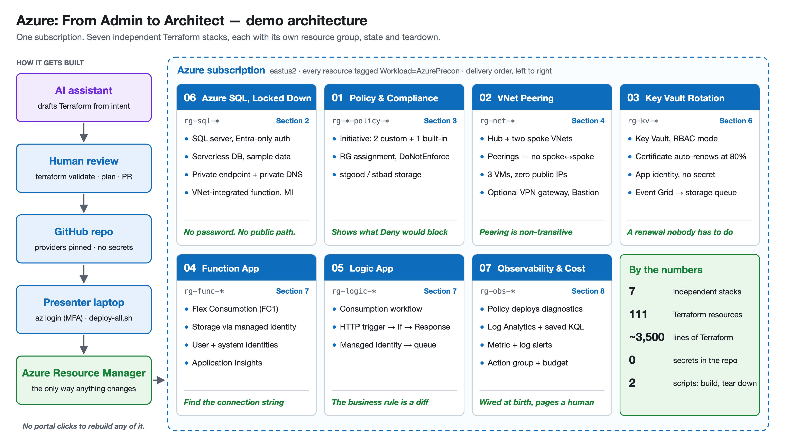

# Azure: From Admin to Architect — 2026 Edition
*Reframed through the Azure Well-Architected Framework & Modern Security/Design*

---

## Opening & Framing

### From Admin to Architect — The Mindset Shift
- An admin keeps services running; an architect makes deliberate trade-offs across competing priorities
- The five WAF pillars — Reliability, Security, Cost Optimization, Operational Excellence, Performance Efficiency — are the language of those trade-offs
- Every decision today gets weighed against the pillars, not against "what we did on-prem"

### The Problem with Lift-and-Shift
- Moving VMs as-is carries forward on-prem assumptions: snowflake servers, manual patching, over-permissioned access
- You pay cloud prices for on-prem architecture — worst of both on cost and operations
- Modernization is a spectrum: rehost → replatform → refactor; pick per workload against business value, not dogma

### What Architecture Is Actually For
- Translating business requirements (RTO/RPO, compliance, budget, scale) into technical design
- Making trade-offs explicit and reviewable, not implicit and accidental
- Use the Azure Well-Architected Review and Azure Advisor to score and prioritize — architecture as a continuous practice

### Shared Responsibility — Know Where Your Job Starts
- IaaS, PaaS, SaaS shift different amounts of burden to Microsoft
- **You always own** data, identity & access, and configuration — regardless of model
- "Trust but verify" the provider; most cloud breaches trace to customer-side misconfiguration, not platform failure

### The Cloud Value Proposition Through WAF
- **IaaS:** elastic compute/storage, higher baseline availability, software-defined networking enabling automation
- **PaaS:** built-in HA, platform backups, automated patching, evergreen versions — DR often costs extra
- WAF lens: PaaS advances Operational Excellence and Reliability, but you still validate DR and govern cost

### Infrastructure as Code — The Architect's Default
- Click-ops doesn't scale and isn't reviewable — define infrastructure in **Bicep / Terraform**, version it in Git
- Deploy through pipelines with policy checks; treat environments as reproducible, not hand-built
- Start from **Azure Verified Modules (AVM)** — Microsoft-maintained Terraform and Bicep modules — rather than hand-writing every resource
- IaC underpins Operational Excellence and makes security/compliance enforceable by default

---

## AI-Assisted IaC — Clickops Should Die

### The Old Excuse for Clickops Is Gone
- Clickops survived on one argument: the portal was faster than writing Terraform or Bicep from scratch
- AI coding assistants (GitHub Copilot, Claude Code, and others) turn a sentence, a whiteboard sketch, or an existing resource into a working first draft in minutes
- When doing it right costs about the same as doing it fast, the portal stops being a shortcut — it becomes a choice to be unreviewable

### The Architect's Job Moves from Typing to Reviewing
- You supply what AI can't guess: requirements, constraints, and trade-offs — RTO, budget, naming, tagging, "no public endpoints"
- The AI drafts; **`terraform plan` is the contract** — read the diff, not the prose
- The skill that matters is review: least privilege, blast radius, cost, and what happens on `destroy`
- AI is just as good at the unglamorous work: explaining inherited code, refactoring into modules, writing the README and the runbook

### Clickops Should Die — Even for "Just This Once"
- If a change takes a minute to describe, it takes a minute to codify — a "quick portal fix" is now drift you chose
- Brownfield is no excuse: **Azure Export for Terraform** (`aztfexport`) captures what exists, and AI cleans it into modules and variables
- Make production read-only for humans: Reader by default, changes through pipelines, break-glass through PIM
- The portal is still the best place to *look* — explore, troubleshoot, learn — then write it down as code

### Guardrails for AI-Written Infrastructure
- Treat AI output like a new engineer's pull request: plan, review, policy check, merge — **AI proposes, the pipeline applies**
- Pin providers and modules (commit the lock file); prefer **Azure Verified Modules** over invented resource arguments
- Let machines check machines: `terraform validate`, linters, and policy-as-code (Azure Policy, Checkov, OPA) catch what a tired reviewer misses
- Keep secrets and tenant data out of prompts; the pipeline deploys with workload identity, not your AI tool's session

### Case Study: This Precon's Architecture

---

## Section 1 — Reliability, High Availability & Recovery

### Designing for Reliability — Start with the Targets
- Define RTO and RPO per workload *first* — redundancy is a means, not a goal
- Map targets to Azure constructs: availability zones, regions, paired regions
- Reliability pillar: redundancy, failure-mode analysis, and **tested** recovery — untested DR is a hope, not a plan

### Availability Zones over Availability Sets
- **Availability Zones** are now the default for VM resilience — physically separate datacenters, higher SLA than sets
- Availability Sets (fault/update domains) still exist but are the legacy single-datacenter option
- Pair zones with zone-redundant load balancing and storage for true datacenter-failure survival

### Virtual Machine Scale Sets
- Identically configured, load-balanced VMs with manual, scheduled, and autoscale options
- Auto-distributes across fault and update domains; flexible orchestration mode is now standard
- Performance Efficiency: scale to real demand with clear thresholds, not fixed over-provisioning

### A 2026 Reliability Reminder
- Regional incidents still happen — single-region designs carry single-region risk
- For mission-critical workloads, plan multi-region geodiversity, not just multi-zone
- Decide consciously: the cost of multi-region vs. the cost of the outage it prevents

### Backup Is the Last Line — Make It Ransomware-Proof
- **Azure Backup** covers VMs, SQL Server in VMs, Azure Files, blobs, managed disks, and AKS — one vault model, one policy model
- Turn on **immutable vaults**, soft delete, and **multi-user authorization** so a compromised admin can't delete the backups too
- Keep backups outside the blast radius: a separate RBAC boundary, and cross-region restore for regional failure

### Azure Site Recovery — DR for What You Can't Re-Platform
- Continuous replication of VMs to a secondary region or zone, with orchestrated **recovery plans**
- **Test failover** into an isolated network without touching production — there's no excuse for an untested plan
- RPO is replication lag; RTO is how long your recovery plan actually takes to run — know both numbers

### Test the Failure, Not Just the Failover
- **Azure Chaos Studio** injects faults (zone down, VM shutdown, NSG block, CPU pressure) into real resources as a controlled experiment
- Schedule DR drills like patching — on a cadence, with an owner, and with the RTO measured, not estimated
- The output of a drill is a number and a list of fixes; if neither changed, it wasn't really a test

---

## Section 2 — Azure SQL, Fabric & Data Platform

### Azure SQL — Deployment Models
- Single database, elastic pool, managed instance — different isolation and consolidation profiles
- Elastic pools optimize cost across many databases with uneven, intermittent usage
- Managed Instance gives near-100% on-prem compatibility for lift-and-shift modernization

### Hyperscale — Scaling Without Re-architecting
- Auto-scales storage to **128 TB** (100 TB per database in a Hyperscale elastic pool) with rapid, independent compute/storage scaling
- Fast backups/restores and near-instant scale operations regardless of data size
- Read-scale-out replicas double as hot standbys — serves both Performance Efficiency and Reliability

### Serverless vs. Provisioned Compute
- **Serverless:** auto-pause/resume, per-second billing — best for intermittent single-DB workloads (available in General Purpose and Hyperscale)
- **Provisioned:** uniform utilization, reserved capacity, hourly billing, Azure Hybrid Benefit eligibility
- Decision driver is workload shape and cost optimization, not feature count

### Azure SQL Managed Instance — Security Posture
- Native VNet integration with private IPs — no public surface by default
- Entra-ID-only authentication, Always Encrypted, TDE with customer-managed keys, Defender for SQL
- Full instance-level compatibility eases migration without sacrificing isolation

### HA in Azure SQL
- Standard model separates compute/storage; premium/business-critical uses a local replica cluster for lowest latency
- Hyperscale uses page servers + log service for fast recovery at scale
- **Zone-redundant** config survives datacenter-level failure within a region
- Reliability: pick tier + zone/geo redundancy to meet stated RTO/RPO; test failover

### Business Continuity for Azure SQL — Restore Is the Test
- **Point-in-time restore** (1–35 days) and **long-term retention** (up to 10 years) are built in — but a backup you've never restored is an assumption
- **Active geo-replication** gives readable secondaries; **failover groups** add a stable listener and fail over a set of databases together
- Choose backup storage redundancy (LRS / ZRS / GRS) deliberately — it decides whether geo-restore is even possible

### Vectors in Azure SQL — AI-Ready Without a New Database
- Native `VECTOR` type, **DiskANN vector indexes**, and `VECTOR_SEARCH` — generally available as of September 2026
- Embeddings live next to the relational data they describe: same security, same backups, same HA, no extra datastore to govern
- The architect's question: does this workload need a dedicated vector store, or just a vector column?

### Demonstration — Azure SQL, Locked Down
- Entra-only authentication: no SQL password exists anywhere
- Turn off public access live; the app keeps working through its private endpoint
- Point-in-time restore, timed — that's your RTO, measured

### Azure DB for PostgreSQL & MySQL
- **Flexible Server** is the only deployment option now — Single Server was retired (MySQL 2024, PostgreSQL 2025)
- Zone-redundant HA, read replicas, burstable-to-business-critical tiers
- Entra ID auth, TLS enforcement, private access, Defender threat protection
- Encryption at rest with customer-managed keys

### Cosmos DB — Globally Distributed by Design
- Multi-region writes, tunable consistency, multiple APIs (NoSQL, MongoDB, Cassandra, Gremlin, Table)
- RU-based throughput — performance and cost are the same dial; size it deliberately
- Performance Efficiency: pick the consistency level that meets correctness needs at lowest latency/cost

### Where Synapse Fits Now
- The old "what's not suitable for Synapse" framing still holds — it's not for OLTP, singleton selects, or row-by-row work
- New analytics investment defaults to **Microsoft Fabric**; Synapse is supported but shrinking (trusted-services firewall exception retired Aug 2026; Synapse Link for Cosmos DB closed to new accounts)
- The **Migration Assistant for Fabric Data Warehouse** (GA) moves dedicated SQL pool schema and data, and flags the T-SQL it can't convert
- For an admin-to-architect audience: don't start new analytics builds on Synapse

### Microsoft Fabric — Analytics as SaaS
- One SaaS platform for the analytics estate: Data Factory, Spark, Data Warehouse, Real-Time Intelligence, Data Science, databases, and Power BI — one capacity, one security model, one lake
- Shared responsibility shifts again: no clusters, VNets, or storage accounts to build — you own **capacity sizing, workspace design, access, and governance**
- **Fabric IQ** (GA in Microsoft Copilot) and data agents answer questions from your semantic models — model quality is now AI quality
- The architect's question changes from "which service?" to "which engine for this workload, and whose capacity pays for it?"

### OneLake — One Copy, Many Engines
- One lake per tenant, organized by workspace; tables land as open **Delta Parquet**
- Spark, the SQL analytics endpoint, KQL, and Power BI **Direct Lake** read the same files — no copy per engine, no import refresh
- **Shortcuts** virtualize ADLS Gen2, S3, GCS, Dataverse, and other workspaces in place — a copy becomes a decision, not a default
- Data lives in the region of the workspace's capacity — plan residency and multi-geo before the first workspace, not after

### Mirroring & Fabric Databases — Operational Data Without ETL
- **Mirroring** continuously replicates Azure SQL, Managed Instance, SQL Server, Cosmos DB, Snowflake, BigQuery, and more into OneLake as Delta — no pipelines to build or babysit
- Replication compute is free, and each capacity unit includes 1 TB of free mirrored storage (F64 = 64 TB) — you pay for the queries
- **SQL database** and **Cosmos DB in Fabric** (GA since Nov 2025) are operational databases that mirror themselves — the shortest path from app data to analytics
- Trade-off: a Fabric database shares its capacity with every other workload on it — Azure SQL still wins for isolated performance, elastic pools, failover groups, or Managed Instance compatibility

### Fabric Capacity Is the Architecture Decision
- Every workload draws from one pool of **capacity units (CUs)** — F SKUs from F2 up, pay-as-you-go with pause/resume, or reserved for roughly 40% off
- **Smoothing** spreads bursts over time; sustained overuse means **throttling** — interactive delays first, then rejections. Surge protection and capacity overage are guardrails, not a substitute for sizing
- Separate capacities by environment and criticality — month-end finance reporting shouldn't queue behind someone's exploratory notebook
- Power BI Premium P SKUs are retiring; the **Capacity Metrics app** is both your sizing tool and your chargeback data

### Securing & Governing Fabric
- Entra ID and Conditional Access front the whole platform; workspace roles → item permissions → **OneLake security** roles that define access once, on the data, for every engine
- Network: tenant- and **workspace-level Private Link** inbound; **outbound access protection** with managed private endpoints; trusted workspace access to firewalled storage
- **Workspace identity** is Fabric's managed identity — connections to Azure resources without stored secrets; **customer-managed keys** for workspace encryption
- **Microsoft Purview** built in: sensitivity labels that follow data into exports, lineage, DLP, and the OneLake catalog

### Fabric as Code — Git, Deployment Pipelines, Terraform
- **Git integration** (Azure DevOps or GitHub) versions workspace items; **deployment pipelines** promote dev → test → prod; **variable libraries** carry per-environment values
- The **Terraform provider for Microsoft Fabric** (GA) manages workspaces, role assignments, and items; `azurerm_fabric_capacity` manages the capacity itself
- Same rule as the rest of the estate: a workspace built by clicking can't be reviewed, reproduced, or rolled back

---

## Section 3 — Governance (The Boring-but-Critical Part)

### Governance Is a Pillar, Not Paperwork
- Management groups → subscriptions → resource groups give you scope for policy, budgets, and access
- Governance enables both Cost Optimization (budgets, chargeback) and Security (guardrails)
- Design the hierarchy intentionally — it's hard to restructure later

### Azure Landing Zones (Cloud Adoption Framework)
- Don't hand-build subscriptions — start from the CAF **Azure landing zone** architecture
- Landing zones bake in identity, networking, policy, and management baselines from day one
- Terraform users: the `caf-enterprise-scale` module was deprecated and archived (Sept 2026) — new builds use **Azure Verified Modules for Platform Landing Zones** (aka.ms/alz/tf)
- Architect's job: adopt the pattern, then tailor — not reinvent governance per project

### Resource Groups & Organization
- Logical grouping tied to lifecycle; can't be nested; each resource belongs to exactly one
- Organize for authorization, lifecycle, and billing — consistent naming and tagging are non-negotiable
- Tags drive cost reporting, automation, and ownership — enforce them via policy

### Management Groups
- Scope above subscriptions for policy and budget targeting with inheritance
- Compliance and cost reporting aligned to org structure (business units, teams)
- Keep the hierarchy shallow and purposeful

### Subscriptions, Limits & Quotas
- Limits (quotas) apply at subscription and sometimes regional level
- Raise soft limits via support request at no charge; design around hard limits
- Architect for quota headroom before you hit it in production

### RBAC — Identity as the Control Plane
- Fine-grained, identity-based access built on Azure Resource Manager: security principal + role + scope
- Grant **least privilege**; segregate duties; prefer built-in roles, create custom only when needed
- Deny assignments take precedence — use sparingly and deliberately

### Retire Classic Admin Roles
- Classic subscription administrator roles (Account/Service/Co-Administrator) are legacy — **fully retired in 2024**
- Use Azure RBAC roles (Owner, Contributor, Reader, User Access Administrator) and Entra ID roles instead
- If you still see Co-Administrators, that's technical debt to clean up

### Privileged Identity Management — Just-in-Time Access
- Standing admin access is a liability — **PIM** grants elevated roles just-in-time, time-boxed, with approval
- Require MFA and justification for activation; auto-expire and audit every elevation
- Core Zero Trust practice: no permanent privilege, verify every escalation

### Entra ID Access Reviews
- Periodic certification that access is still needed — for groups, app assignments, and privileged roles
- Reviewers: specified users, group owners, or self-review; surfaced via the access panel / portal
- Closes the loop on access creep — pairs with PIM and least privilege

### Azure Policy — Compliance as Code
- Policy differs from RBAC: RBAC controls *who can act*, Policy controls *what's allowed to exist*
- Define → assign to scope → evaluate compliance; group into initiatives for whole-estate guardrails
- Import from GitHub or write custom JSON; enforce locations, SKUs, tags, encryption — automatically

### Demonstration — Policy & Compliance
- Assign a policy / initiative
- View non-compliant resources and remediate

---

## Section 4 — Networking & Network Security

### Network Design Through a Zero Trust Lens
- VNets, subnets, and address spaces are the foundation — plan non-overlapping ranges, secure subnets with NSGs
- But the perimeter is no longer the network — **identity is the perimeter**; network controls *where*, identity controls *who*
- Layer both: private connectivity + identity-based access = defense in depth

### Connectivity Options
- To internet: outbound must be explicit on new VNets (next slide); inbound via public IP or load balancer (minimize public exposure)
- Between Azure resources: VNet, service/private endpoints, VNet peering
- To on-prem: point-to-site, site-to-site VPN, ExpressRoute

### Outbound Is Now a Design Decision
- Default outbound access is retired for new VNets (March 31, 2026) — subnets are created private, with no implicit internet egress
- Choose explicitly: **NAT Gateway** for simple egress, **Azure Firewall** in the hub for inspected egress, load balancer outbound rules for legacy patterns
- Existing VNets keep working — but on behavior Microsoft has retired; plan the migration rather than waiting for a redeploy to break it

### Private Endpoints over Service Endpoints over Public
- **Private Link / private endpoints** are the modern default — the service joins your VNet, traffic stays on the Microsoft backbone, public IP eliminated
- Service endpoints are the older, coarser option; public access should be disabled wherever possible
- **Network Security Perimeter** draws a boundary around PaaS-to-PaaS traffic that never touches a VNet (GA for Storage, Key Vault, Monitor and others; SQL and Cosmos DB in preview)
- This is the single highest-leverage data-plane security move for PaaS

### VNet Peering & Hub-and-Spoke
- Peering is non-transitive; reciprocal connections required; cross-subscription supported
- Global peering connects regions; gateway transit enables hub-and-spoke shared connectivity
- Hub-and-spoke centralizes shared services (firewall, DNS, gateways) — the standard enterprise topology

### Demonstration — VNet Peering
- Configure peering, VPN gateway, gateway transit; confirm connectivity

### Load Balancing — Pick the Right Layer
- **Azure Load Balancer** (L4): source/destination IP, port, protocol — zone-redundant for resilience
- **Standard SKU only** — Basic Load Balancer and Basic public IPs were retired Sept 30, 2025
- **Application Gateway** (L7): path-based and multi-site routing, redirection, header rewrite
- Match the tool to the traffic; combine with zones for HA

### Application Gateway + WAF
- **v2 only** — Application Gateway v1 was retired April 28, 2026
- Components: frontend IP, listeners, routing rules, backend pools, health probes
- **Web Application Firewall** protects against OWASP Top 10 — enable it on Application Gateway and Front Door
- Run WAF in prevention mode in production, not just detection

### Azure Front Door & Traffic Manager
- **Traffic Manager** (DNS-based): priority, performance, geographic, weighted routing with health checks
- **Front Door** adds global L7 acceleration, WAF, and TLS offload at the edge — often the better modern choice for web apps
- Choose by need: DNS-level failover vs. full edge delivery + security

### Azure Firewall
- Built-in HA, availability zones, cloud-scale; FQDN and network filtering rules; threat intelligence
- Centralize in the hub for hub-and-spoke egress control
- Pair with Firewall Manager and DNS proxy for policy at scale

### NSGs & Application Security Groups
- NSGs filter subnet/NIC traffic; **service tags** simplify rules (Storage, SQL, AzureLoadBalancer, etc.)
- **ASGs** scope rules to logical groups of resources instead of IP ranges — far more maintainable
- Layer NSGs (network) under identity and Firewall (centralized) for defense in depth

### Azure Bastion — Kill the Public RDP/SSH Surface
- RDP/SSH directly in the portal over TLS — **no public IP on the VM**, no internet-exposed management ports
- Protection against port scanning and management-plane exposure
- SKUs from free **Developer** (dev/test) to **Premium** (session recording, private-only deployment)
- This eliminates one of the most-attacked surfaces in IaaS; treat public 3389/22 as a finding

---

## Section 5 — Virtual Machines & Storage

### VM Deployment Checklist — Architect's Version
- Start with the network and security (subnets, NSGs, no public IP by default)
- Right-size deliberately (general/compute/memory/storage/GPU/HPC); name and tag per convention
- Choose managed disks, plan storage tier, select OS — and understand the pricing model before deploying

### VM Sizing — Match the Workload
- Families map to workload shape: general-purpose, compute-, memory-, storage-optimized, GPU, HPC
- GPU families now matter for AI training/inference, not just rendering
- Older families keep retiring (e.g., original B-series by Nov 2028) — standardize on current generations and check the retirement list first
- Performance Efficiency: size to observed demand, then revisit — don't guess high "to be safe"

### VM Cost Model — Compute + Storage
- Two costs per VM: compute and storage
- Compute payment options: pay-as-you-go, **Reserved Instances**, and **Savings Plans** (flexible across instance types)
- Cost Optimization: combine reservations/savings plans for the steady floor, PAYG for the variable peak; add Hybrid Benefit

### Managed Disks & SQL Storage Best Practices
- Disk tiers: Standard HDD, Standard SSD, Premium SSD, **Premium SSD v2**, Ultra — SQL belongs on Premium SSD v2, Premium, or Ultra
- **Premium SSD v2** sets capacity, IOPS, and throughput independently — usually the best price/performance for SQL Server data and log
- Separate data and log volumes; stripe for IOPS; read caching on Premium SSD data disks (v2 and Ultra have no host caching); enable Instant File Initialization
- Temporary disk is ephemeral — only for TempDB and other recreatable data

### Encryption & Disk Security
- Encryption at rest is on by default; use **customer-managed keys** in Key Vault for sensitive workloads
- Use **encryption at host** for end-to-end coverage (temp disk and caches included) — Azure Disk Encryption retires Sept 15, 2028, so don't start new builds on it
- Confidential computing options exist for data-in-use protection on sensitive workloads

### Azure Storage — Services & Account Types
- One account groups Blob, File, Queue, Table; choose GPv2 as the modern default
- Redundancy: LRS, ZRS, GRS, GZRS — map to your durability and residency requirements
- Blob tiers (Hot/Cool/Cold/Archive) + lifecycle management automate cost optimization

### Securing Storage — Move Past Keys and SAS
- **Default to Entra ID authentication** for data-plane access — not account keys, not ad-hoc SAS
- Account keys grant full access and are hard to govern — **disable shared-key access** where possible
- If SAS is required, prefer **user-delegation SAS** (Entra-backed), scope tightly (time, IP, permission), and disable public blob access
- Use private endpoints + firewall on storage; treat public storage exposure as a finding

---

## Section 6 — Identity, Secrets & Security Posture

### Entra ID — The Identity Foundation
- Cloud identity and access management: SSO, MFA, conditional access, device registration, monitoring
- "Azure AD" is now **Microsoft Entra ID** — same backbone, current name; update your mental model and docs
- Identity is the control plane for everything else in this deck

### Conditional Access — The Zero Trust Gate
- Verify explicitly: evaluate identity, device compliance, location, and risk on every access request
- Enforce MFA, block legacy auth, require compliant devices — different thresholds for different data
- This is where "assume breach" becomes concrete policy

### Mandatory MFA for Azure — The Platform Now Insists
- MFA is enforced for the Azure portal (since Oct 2024) and for Azure CLI, PowerShell, REST, and IaC tools on create/update/delete (since Oct 2025)
- Automation running as a human account breaks — scripts and pipelines belong on **managed identities** or **workload identity federation**, which aren't subject to it
- Treat it as the floor, not the policy: Conditional Access still decides *how strong* and *from where*

### Users, Groups & External Identities
- Cloud, directory-synced, and guest identities; security vs. Microsoft 365 groups; assigned vs. dynamic membership
- **B2B** lets partners use their own credentials — no external account management for you
- **Entra External ID** handles customer-facing identity with standards-based auth (OIDC, OAuth2, SAML) — Azure AD B2C closed to new customers in May 2025, so new builds start on External ID

### Managed Identities — Eliminate Credentials in Code
- Combine Entra ID auth with RBAC so apps authenticate **without stored secrets**
- System-assigned (tied to one resource) vs. user-assigned (shared across resources)
- Default pattern for service-to-service auth — no keys to rotate, nothing to leak

### Workload Identity Federation — Pipelines Without Secrets
- GitHub Actions, Azure DevOps, HCP Terraform, and Kubernetes exchange their own OIDC token for an Entra token — **no client secret to store or rotate**
- Federate a user-assigned managed identity or app registration to one repo, branch, or environment — the trust is that narrow
- This is what "IaC through pipelines" looks like after mandatory MFA: no human in the loop, no secret in the vault

### Azure Key Vault — Secrets, Keys, Certificates
- Centralized, access-controlled storage for secrets, keys, and certificates; HSM-backed options
- **Azure RBAC** is the default for new vaults (API version 2026-02-01) — access policies are legacy, and older control-plane API versions retire Feb 27, 2027
- Grant access at narrow scope; enable soft-delete and purge protection
- Pair with managed identities so apps retrieve secrets without ever holding credentials

### Demonstration — Certificate Auto-Rotation in Key Vault
- Configure automated certificate rotation to remove manual renewal risk

### Defender for Cloud — Posture You Can Measure
- **Secure score** turns "are we secure?" into a number with a prioritized list of recommendations
- Free foundational CSPM for everyone; paid Defender plans add workload protection (servers, SQL, storage, Key Vault) and attack-path analysis
- Wire it into governance: owners and due dates on recommendations, alerts flowing to your SIEM (Microsoft Sentinel)

---

## Section 7 — Automation & Serverless

### Automation Is the Architect's Force Multiplier
- Manual tasks don't scale and aren't auditable — automate, then govern the automation
- Azure Automation Runbooks for operational tasks; pair with managed identities, not stored credentials
- Operational Excellence: codify runbooks, observability, and on-call practice

### Azure Automation Runbooks
- PowerShell and Python runbooks in **runtime environments**; graphical authoring available
- Python 2.7/3.8 and PowerShell 7.1/7.2 runtimes were retired Sept 30, 2026 — target PowerShell 7.6 (PowerShell Workflow is 5.1-only; don't write new ones)
- Run in an Azure sandbox or on an extension-based Hybrid Runbook Worker for on-prem/local resources
- Source from the gallery or your own repo; trigger via portal, webhook, schedule, or an Azure Monitor alert

### Azure Functions — Event-Driven Compute
- Trigger on HTTP, timers, queues, blobs, Event Grid, Event Hubs, Service Bus, Cosmos DB changes, SQL changes
- Hosting: **Flex Consumption** (the serverless default — VNet integration, always-ready instances), Premium, Dedicated, and Container Apps; KEDA for self-hosted Kubernetes
- Linux Consumption retires Sept 30, 2028 and gets no new language versions — migrate with `az functionapp flex-migration`
- Durable Functions add stateful orchestration; pay-per-use aligns cost to actual execution

### Demonstration — Create a Function App
- Create and verify a function app

### Azure Logic Apps — Workflow Orchestration
- Schedule, automate, and orchestrate across apps, data, and services with low-code workflows
- Trigger-driven: an event fires, the engine runs the action sequence
- **Consumption** (multi-tenant, pay per action) vs. **Standard** (single-tenant, VNet integration, local dev and source control)
- Hundreds of connectors plus custom connectors; graphical designer for building and maintaining flows

### Demonstration — Logic App Workflow
- Create a logic app, add a trigger, run it

---

## Section 8 — Operations: Observability & Cost

### You Can't Operate What You Can't See
- Operational Excellence and Reliability both depend on telemetry you decided to collect *before* the incident
- **Azure Monitor** is one platform: metrics (fast, numeric, 93 days), logs (rich, queried with KQL), traces (Application Insights / OpenTelemetry)
- Platform metrics are free and on by default; resource logs are **off** until you send them somewhere

### Log Analytics Workspace Design
- Fewer workspaces is better — one per region or environment boundary, not one per app; cross-workspace queries are a tax
- Table plans control cost: **Analytics** for alerting and dashboards, **Basic / Auxiliary** for high-volume logs you rarely query
- Set retention per table; keep long-term data in long-term retention instead of paying analytics prices for it

### Collect at Scale — Policy, DCRs, and the Monitor Agent
- Don't hand-configure diagnostic settings per resource — assign **DeployIfNotExists** policies at the landing zone so every new resource is wired at birth
- Built-in policies enable logging by **category group** (`audit` or `allLogs`) — choosing between them is a cost decision
- VMs and Arc servers use the **Azure Monitor Agent** with data collection rules; the legacy Log Analytics (MMA) agent retired Aug 31, 2024

### Alerts That Wake the Right Person
- Alert on **symptoms users feel** (errors, latency, availability), not every cause — noisy alerts train people to ignore them
- **Metric alerts** are fast (about a minute); **log alerts** are richer (who, what, from where) but slower — use both, deliberately
- **Action groups** route to email, SMS, push, webhooks, ITSM, or a runbook; every alert needs an owner and a next step

### Application Insights & OpenTelemetry
- Workspace-based Application Insights keeps app telemetry in the same Log Analytics workspace as platform logs — one query surface
- The **Azure Monitor OpenTelemetry Distro** is the instrumentation default for new code — vendor-neutral, no proprietary SDK lock-in
- Distributed tracing turns "the app is slow" into "this dependency call is slow" — a Performance Efficiency conversation with evidence

### Cost Management — Budgets Are Alerts Too
- **Budgets** at subscription and resource-group scope, on actual *and* forecasted spend, routed to the same action groups as ops alerts
- **Anomaly alerts** catch the runaway resource before month-end does
- Cost data lags by hours — budgets are a governance control, not a real-time circuit breaker

### FinOps — Make Cost Somebody's Job
- Tags + Cost Management give showback and chargeback by team; untagged spend is unowned spend
- **Azure Advisor** cost recommendations (rightsizing, idle resources, reservation and savings plan coverage) on a monthly review cadence
- Export cost data in the **FOCUS** format and use the FinOps toolkit for reporting across subscriptions, clouds, and time

### Demonstration — Observability & Cost Guardrails
- Diagnostic settings deployed by policy, not by hand
- Generate denied requests, find them in KQL, and get the alert on your phone
- A budget routed to the same action group

---

## Closing

### The Same Rules Apply to AI Workloads
- An AI app is still a workload: private endpoints for model endpoints, managed identity instead of API keys, diagnostic logs on by default
- Cost is per token — model choice, caching, and provisioned vs. pay-as-you-go throughput are the new right-sizing
- Reliability means quota and region planning for model capacity; Security adds prompt injection and content filtering to the threat model

### The Architect's WAF Checklist
- **Reliability:** RTO/RPO defined, zones/regions chosen to match, backups immutable, recovery tested and timed
- **Security:** Zero Trust, identity-as-perimeter, private endpoints, no standing privilege, no secrets in pipelines, encryption with CMK
- **Cost Optimization:** reservations + savings plans, tagging/chargeback, budgets + anomaly alerts, lifecycle policies
- **Operational Excellence:** IaC (Bicep/Terraform) through pipelines, diagnostics by policy, alerts with owners, runbooks
- **Performance Efficiency:** right-size to real demand, match service to workload, scale on thresholds

### From Admin to Architect — Where to Start Monday
- Run an Azure Well-Architected Review on one real workload — score, don't guess
- Pick the three highest-risk gaps (often: public exposure, standing admin, untested restore) and close them
- Move one manual process to IaC or automation — build the habit, then scale it
